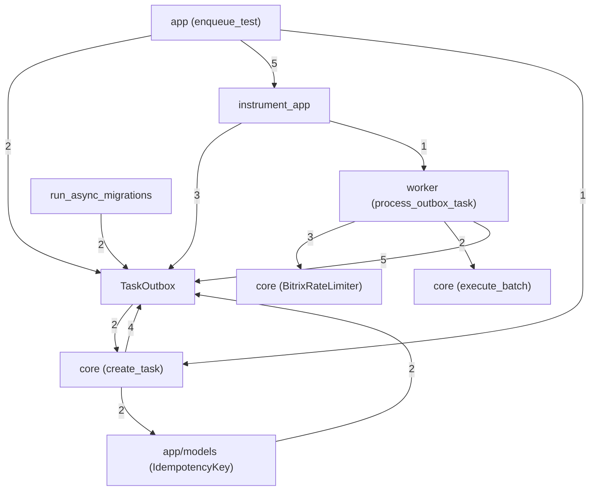

# Codebase Architecture Analysis Prompt

You are a senior software architect. Using the knowledge-graph metadata and component relationships below, write a deep **AI Architectural Insights** report for this project **in English**.

**Important**: Write the full report into the `## AI Architectural Insights` section of `.codegraph/README.md` (keep this English heading so rebuilds can preserve prior insights).

## Graph statistics
- Files: 24
- Symbols (classes/functions/methods): 52
- Edges: 101
- Edge resolution: 114/664 (17.2%)
- Unresolved edges: 550
- Internal resolution: 114/120 (95.0%), internal_unresolved=6
- Unresolved by category: external=253, builtin=83, attribute=208, internal=6

## Logical components (modularity)
- TaskOutbox: cohesion=0.1500, members_count=9
- instrument_app: cohesion=0.2100, members_count=7
- app (enqueue_test): cohesion=0.1400, members_count=7
- core (create_task): cohesion=0.1400, members_count=7
- run_async_migrations: cohesion=0.2000, members_count=6
- worker (process_outbox_task): cohesion=0.2000, members_count=6
- core (BitrixRateLimiter): cohesion=0.2500, members_count=5
- e2eCheck (Component 8): cohesion=0.3300, members_count=3
- e2eCheck (Component 9): cohesion=0.3300, members_count=3
- migrations/versions (downgrade) (downgrade): cohesion=0.3300, members_count=3
- migrations/versions (downgrade) (downgrade): cohesion=0.3300, members_count=3
- migrations/versions (downgrade) (downgrade): cohesion=0.3300, members_count=3
- migrations/versions (downgrade) (downgrade): cohesion=0.3300, members_count=3
- migrations/versions (downgrade) (downgrade): cohesion=0.3300, members_count=3
- migrations/versions (downgrade) (downgrade): cohesion=0.3300, members_count=3
- app/models (IdempotencyKey): cohesion=0.5000, members_count=2
- core (execute_batch): cohesion=0.5000, members_count=2
- tests: cohesion=0.0000, members_count=1

## Component dependency graph (Mermaid)


## God nodes (highest degree)
- main.py (file): degree=13, file=app/main.py
- tasks.py (file): degree=11, file=worker/tasks.py
- db.py (file): degree=10, file=app/db.py
- outbox.py (file): degree=9, file=core/outbox.py
- settings.py (file): degree=8, file=worker/settings.py
- config.py (file): degree=7, file=app/config.py
- env.py (file): degree=7, file=migrations/env.py
- outbox.py (file): degree=6, file=app/models/outbox.py
- TaskOutbox (class): degree=6, file=app/models/outbox.py
- process_outbox_task (function): degree=6, file=worker/tasks.py

## File-level import cycles
No circular imports

Focus your analysis on:
1. **System architecture** — design patterns, modularity, physical vs logical alignment.
2. **Core abstractions & boundaries** — which god nodes are healthy hubs vs fat objects.
3. **Bottlenecks & refactoring** — coupling risks, cycle impact, concrete decoupling steps.

Output standard Markdown only (no surrounding ```markdown fences).
