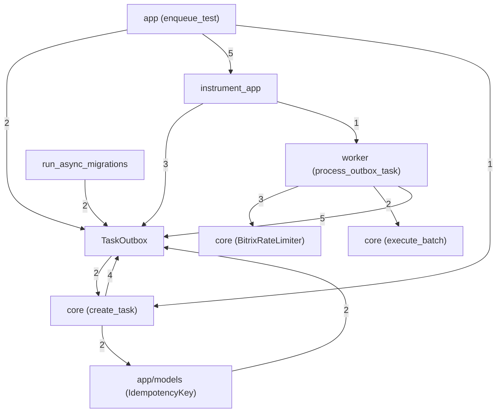

# Codebase Knowledge Graph

Welcome to the codebase knowledge graph of this workspace. This index represents files, classes, structs, methods, and functions as nodes, with call and dependency relationships between them.

## Statistics
- **Files Scanned:** 24
- **Symbols Extracted:** 52
- **Call/Relation Edges:** 101
- **Edge Resolution:** 114/664 resolved (17.2%)
- **Unresolved Edges:** 550
- **Internal Resolution:** 114/120 (95.0%), internal unresolved=6
- **Unresolved by Category:** external=253, builtin=83, attribute=208, internal=6
- **Relation Mix:** calls=23, contains=49, imports=27, inherits=2

## Architecture Overview
This project is built using a modular software system design. The static parser performs a full scan of the codebase to generate the underlying dependency network, and the knowledge graph groups symbols into logical components using a community detection algorithm (Component-level clustering).

### Physical Structure & Layout
- **`app/`** : contains 8 source files (e.g., `config.py`, `logging_config.py`, `telemetry.py` etc.).
- **`migrations/`** : contains 7 source files (e.g., `env.py`, `dc3cd7a06e30_add_trace_id_to_tasks_outbox.py`, `b567e79a02bb_add_processing_started_at_to_tasks_.py` etc.).
- **`core/`** : contains 4 source files (e.g., `rate_limiter.py`, `publisher.py`, `outbox.py` etc.).
- **Root directory `.`** : contains 3 configuration or source files.
- **`worker/`** : contains 2 source files (e.g., `settings.py`, `tasks.py`).

### Core Execution Entrypoints
- `instrument_app` (defined in [app/telemetry.py](nodes/app_telemetry_py.md))
- `run_migrations_offline` (defined in [migrations/env.py](nodes/migrations_env_py.md))
- `do_run_migrations` (defined in [migrations/env.py](nodes/migrations_env_py.md))
- `run_async_migrations` (defined in [migrations/env.py](nodes/migrations_env_py.md))
- `run_migrations_online` (defined in [migrations/env.py](nodes/migrations_env_py.md))

### Control Flow & Data Dependencies
Data flow and control logic in the system center around core classes and components. The main components and their logical topological call relationships are shown in the diagram below, visualizing the core component interaction model.

## Component Dependency Graph

## Logical Components Summary
The codebase has been automatically clustered into logical components based on coupling and call density:

| Component | Cohesion (Density) | Size (Nodes) |
|---|---|---|
| [TaskOutbox](components/TaskOutbox.md) | 0.15 | 9 |
| [instrument_app](components/instrument_app.md) | 0.21 | 7 |
| [app (enqueue_test)](components/app_enqueue_test_.md) | 0.14 | 7 |
| [core (create_task)](components/core_create_task_.md) | 0.14 | 7 |
| [run_async_migrations](components/run_async_migrations.md) | 0.2 | 6 |
| [worker (process_outbox_task)](components/worker_process_outbox_task_.md) | 0.2 | 6 |
| [core (BitrixRateLimiter)](components/core_BitrixRateLimiter_.md) | 0.25 | 5 |
| [e2eCheck (Component 8)](components/e2eCheck_Component_8_.md) | 0.33 | 3 |
| [e2eCheck (Component 9)](components/e2eCheck_Component_9_.md) | 0.33 | 3 |
| [migrations/versions (downgrade) (downgrade)](components/migrations_versions_downgrade_downgrade_.md) | 0.33 | 3 |
| [migrations/versions (downgrade) (downgrade)](components/migrations_versions_downgrade_downgrade_.md) | 0.33 | 3 |
| [migrations/versions (downgrade) (downgrade)](components/migrations_versions_downgrade_downgrade_.md) | 0.33 | 3 |
| [migrations/versions (downgrade) (downgrade)](components/migrations_versions_downgrade_downgrade_.md) | 0.33 | 3 |
| [migrations/versions (downgrade) (downgrade)](components/migrations_versions_downgrade_downgrade_.md) | 0.33 | 3 |
| [migrations/versions (downgrade) (downgrade)](components/migrations_versions_downgrade_downgrade_.md) | 0.33 | 3 |
| [app/models (IdempotencyKey)](components/app_models_IdempotencyKey_.md) | 0.5 | 2 |
| [core (execute_batch)](components/core_execute_batch_.md) | 0.5 | 2 |
| [tests](components/tests.md) | 0 | 1 |

## God Nodes (Top Core Abstractions)
These symbols have the highest degrees (most connections) in the codebase. Test paths are excluded. Modifying them may have wide-reaching effects:

| Symbol | Type | Degree | In | Out | File |
|---|---|---|---|---|---|
| [main.py](nodes/app_main_py.md) | `file` | 13 | 0 | 13 | `app/main.py` |
| [tasks.py](nodes/worker_tasks_py.md) | `file` | 11 | 1 | 10 | `worker/tasks.py` |
| [db.py](nodes/app_db_py.md) | `file` | 10 | 7 | 3 | `app/db.py` |
| [outbox.py](nodes/core_outbox_py.md) | `file` | 9 | 0 | 9 | `core/outbox.py` |
| [settings.py](nodes/worker_settings_py.md) | `file` | 8 | 0 | 8 | `worker/settings.py` |
| [config.py](nodes/app_config_py.md) | `file` | 7 | 6 | 1 | `app/config.py` |
| [env.py](nodes/migrations_env_py.md) | `file` | 7 | 0 | 7 | `migrations/env.py` |
| [outbox.py](nodes/app_models_outbox_py.md) | `file` | 6 | 4 | 2 | `app/models/outbox.py` |
| [TaskOutbox](nodes/app_models_outbox_py_TaskOutbox.md) | `class` | 6 | 5 | 1 | `app/models/outbox.py` |
| [process_outbox_task](nodes/worker_tasks_py_process_outbox_task.md) | `function` | 6 | 1 | 5 | `worker/tasks.py` |

## Unresolved Edge Samples
Representative edges that could not be bound to a graph symbol, classified as internal / external / builtin / attribute:

| Category | Relation | Source | Target |
|---|---|---|---|
| `external` | `imports` | `app/config.py` | `pydantic_settings` |
| `external` | `inherits` | `app/config.py::Settings` | `BaseSettings` |
| `external` | `calls` | `app/config.py::Settings` | `SettingsConfigDict` |
| `external` | `imports` | `app/logging_config.py` | `logging` |
| `external` | `imports` | `app/logging_config.py` | `sys` |
| `external` | `calls` | `app/logging_config.py::setup_logging` | `logging.basicConfig` |
| `external` | `imports` | `app/telemetry.py` | `logging` |
| `external` | `imports` | `app/telemetry.py` | `opentelemetry` |
| `external` | `imports` | `app/telemetry.py` | `opentelemetry.sdk.trace` |
| `external` | `imports` | `app/telemetry.py` | `opentelemetry.sdk.trace.export` |
| `external` | `imports` | `app/telemetry.py` | `opentelemetry.sdk.resources` |
| `external` | `imports` | `app/telemetry.py` | `opentelemetry.exporter.otlp.proto.grpc.trace_exporter` |
| `attribute` | `calls` | `app/telemetry.py::setup_tracing` | `Resource.create` |
| `attribute` | `calls` | `app/telemetry.py::setup_tracing` | `provider.add_span_processor` |
| `attribute` | `calls` | `app/telemetry.py::setup_tracing` | `trace.set_tracer_provider` |
| `attribute` | `calls` | `app/telemetry.py::instrument_app` | `HTTPXClientInstrumentor().instrument` |
| `attribute` | `calls` | `app/models/idempotency.py::IdempotencyKey` | `func.now` |
| `attribute` | `calls` | `app/main.py` | `Instrumentator().instrument(app).expose` |
| `attribute` | `calls` | `app/main.py` | `Instrumentator().instrument` |
| `attribute` | `calls` | `app/main.py::health_db` | `session.execute` |

## Circular Import Dependencies
No circular imports detected. Perfect modularity!

## AI Architectural Insights
> 💡 **Tip**: AI architectural insights have not been generated yet. Please use your AI Agent (e.g., Antigravity, Claude Code, Codex) to read the prompt in `.codegraph/AGENT_PROMPT.md` and fill in the analysis results here.
