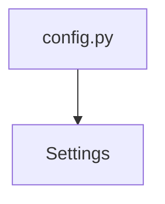

# config.py

**Type:** `file`  
**File path:** `app/config.py`  
**Component:** instrument_app  

## Definition
```python
module config.py
```

## Imported By
- [telemetry.py](app_telemetry_py.md)
- [db.py](app_db_py.md)
- [bitrix_batch.py](core_bitrix_batch_py.md)
- [settings.py](worker_settings_py.md)
- [publisher.py](core_publisher_py.md)
- [env.py](migrations_env_py.md)
- [tasks.py](worker_tasks_py.md)

## Call Graph


### Outgoing Calls
- Calls [Settings](app_config_py_Settings.md) (`class`)
