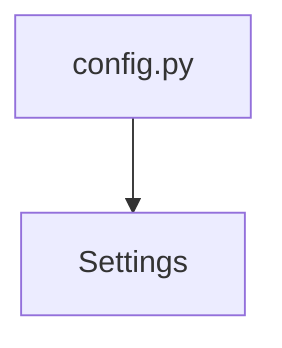

# Settings

**Type:** `class`  
**Defined in:** [app/config.py](../nodes/app_config_py.md) (Lines 4-26)  
**Component:** instrument_app  

## Definition
```python
class Settings(BaseSettings)
```

## Call Graph


### Incoming Calls (Backlinks)
- Called by [config.py](app_config_py.md) (`file`)
