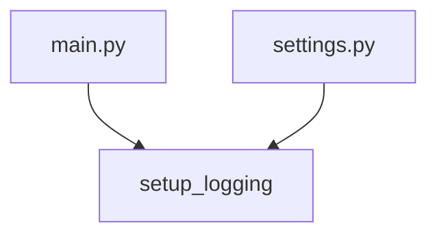

# setup_logging

**Type:** `function`  
**Defined in:** [app/logging_config.py](../nodes/app_logging_config_py.md) (Lines 5-12)  
**Component:** app (setup_logging)  

## Definition
```python
def setup_logging(level: str = "INFO") -> None
```

## Description
Настроить логирование: время, уровень, модуль, сообщение.

**Contained in parent:** [logging_config.py](app_logging_config_py.md) (`file`)

## Call Graph


### Incoming Calls (Backlinks)
- Called by [settings.py](worker_settings_py.md) (`file`)
- Called by [main.py](app_main_py.md) (`file`)
