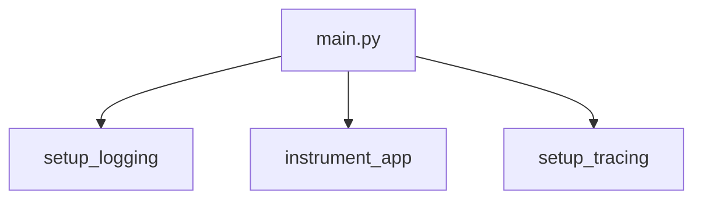

# main.py

**Type:** `file`  
**File path:** `app/main.py`  
**Component:** app (enqueue_test)  

## Definition
```python
module main.py
```

## Contains Symbols
- [health](app_main_py_health.md) (`function`)
- [health_db](app_main_py_health_db.md) (`function`)
- [root](app_main_py_root.md) (`function`)
- [enqueue_test](app_main_py_enqueue_test.md) (`function`)
- [get_task_status](app_main_py_get_task_status.md) (`function`)
- [queue_metrics](app_main_py_queue_metrics.md) (`function`)

## Imports
- [db.py](app_db_py.md)
- [outbox.py](app_models_outbox_py.md)
- [telemetry.py](app_telemetry_py.md)
- [logging_config.py](app_logging_config_py.md)

## Call Graph


### Outgoing Calls
- Calls [setup_logging](app_logging_config_py_setup_logging.md) (`function`)
- Calls [setup_tracing](app_telemetry_py_setup_tracing.md) (`function`)
- Calls [instrument_app](app_telemetry_py_instrument_app.md) (`function`)
