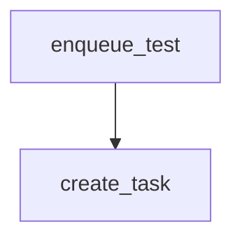

# enqueue_test

**Type:** `function`  
**Defined in:** [app/main.py](../nodes/app_main_py.md) (Lines 57-64)  
**Component:** app (enqueue_test)  

## Definition
```python
async def enqueue_test(key: str | None = None)
```

**Contained in parent:** [main.py](app_main_py.md) (`file`)

## Call Graph


### Outgoing Calls
- Calls [create_task](core_outbox_py_create_task.md) (`function`)
