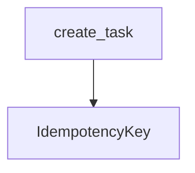

# IdempotencyKey

**Type:** `class`  
**Defined in:** [app/models/idempotency.py](../nodes/app_models_idempotency_py.md) (Lines 11-20)  
**Component:** app (Base)  

## Definition
```python
class IdempotencyKey(Base)
```

**Contained in parent:** [idempotency.py](app_models_idempotency_py.md) (`file`)

## Inherits / Implements
- [Base](app_db_py_Base.md) (`class`)

## Call Graph


### Incoming Calls (Backlinks)
- Called by [create_task](core_outbox_py_create_task.md) (`function`)
