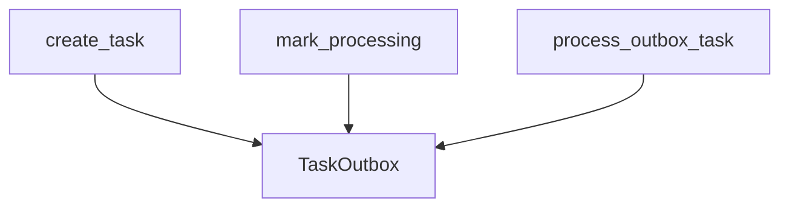

# TaskOutbox

**Type:** `class`  
**Defined in:** [app/models/outbox.py](../nodes/app_models_outbox_py.md) (Lines 11-29)  
**Component:** TaskOutbox  

## Definition
```python
class TaskOutbox(Base)
```

**Contained in parent:** [outbox.py](app_models_outbox_py.md) (`file`)

## Inherits / Implements
- [Base](app_db_py_Base.md) (`class`)

## Call Graph


### Incoming Calls (Backlinks)
- Called by [create_task](core_outbox_py_create_task.md) (`function`)
- Called by [mark_processing](core_outbox_py_mark_processing.md) (`function`)
- Called by [process_outbox_task](worker_tasks_py_process_outbox_task.md) (`function`)
