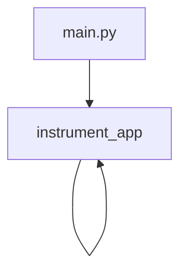

# instrument_app

**Type:** `function`  
**Defined in:** [app/telemetry.py](../nodes/app_telemetry_py.md) (Lines 35-55)  
**Component:** instrument_app  

## Definition
```python
def instrument_app(app)
```

## Description
Подключает автоинструментацию FastAPI, httpx, SQLAlchemy.

**Contained in parent:** [telemetry.py](app_telemetry_py.md) (`file`)

## Call Graph


### Outgoing Calls
- Calls [instrument_app](app_telemetry_py_instrument_app.md) (`function`)

### Incoming Calls (Backlinks)
- Called by [instrument_app](app_telemetry_py_instrument_app.md) (`function`)
- Called by [main.py](app_main_py.md) (`file`)
