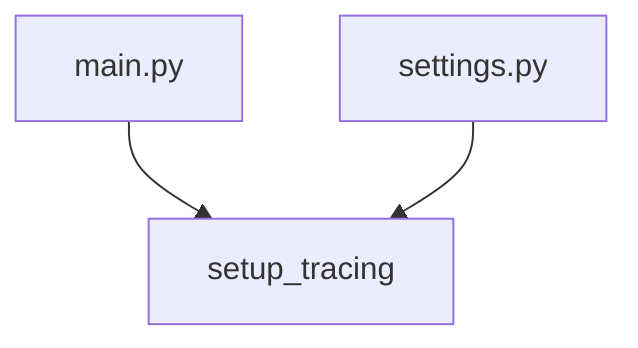

# setup_tracing

**Type:** `function`  
**Defined in:** [app/telemetry.py](../nodes/app_telemetry_py.md) (Lines 14-32)  
**Component:** instrument_app  

## Definition
```python
def setup_tracing(service_name: str = "fastapi-project")
```

## Description
Настраивает TracerProvider и отправляет спаны в OTel Collector.

**Contained in parent:** [telemetry.py](app_telemetry_py.md) (`file`)

## Call Graph


### Incoming Calls (Backlinks)
- Called by [main.py](app_main_py.md) (`file`)
- Called by [settings.py](worker_settings_py.md) (`file`)
