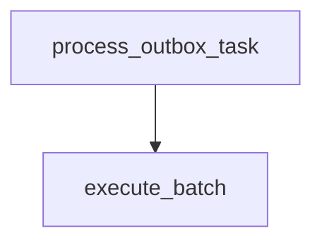

# execute_batch

**Type:** `function`  
**Defined in:** [core/bitrix_batch.py](../nodes/core_bitrix_batch_py.md) (Lines 11-96)  
**Component:** core (execute_batch)  

## Definition
```python
async def execute_batch(commands: dict[str, str]) -> dict[str, Any]
```

## Description
Выполняет batch-запрос к Битрикс24.

**Contained in parent:** [bitrix_batch.py](core_bitrix_batch_py.md) (`file`)

## Call Graph


### Incoming Calls (Backlinks)
- Called by [process_outbox_task](worker_tasks_py_process_outbox_task.md) (`function`)
