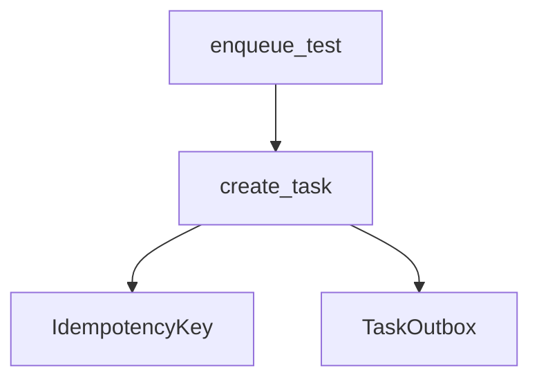

# create_task

**Type:** `function`  
**Defined in:** [core/outbox.py](../nodes/core_outbox_py.md) (Lines 14-45)  
**Component:** core (create_task)  

## Definition
```python
async def create_task(payload: dict, key: str | None = None) -> uuid.UUID | None
```

## Description
Записать задачу в outbox со статусом pending.

    Если key передан и уже существует — вернуть None (дубль, не создаём).
    Сохраняет trace_id текущего спана (для сквозной трассировки).

**Contained in parent:** [outbox.py](core_outbox_py.md) (`file`)

## Call Graph


### Outgoing Calls
- Calls [TaskOutbox](app_models_outbox_py_TaskOutbox.md) (`class`)
- Calls [IdempotencyKey](app_models_idempotency_py_IdempotencyKey.md) (`class`)

### Incoming Calls (Backlinks)
- Called by [enqueue_test](app_main_py_enqueue_test.md) (`function`)
