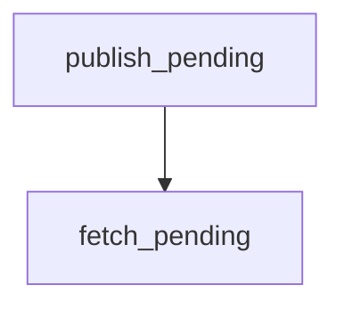

# fetch_pending

**Type:** `function`  
**Defined in:** [core/outbox.py](../nodes/core_outbox_py.md) (Lines 48-57)  
**Component:** core (create_task)  

## Definition
```python
async def fetch_pending(limit: int = 100) -> list[TaskOutbox]
```

## Description
Взять пачку pending-задач.

**Contained in parent:** [outbox.py](core_outbox_py.md) (`file`)

## Call Graph


### Incoming Calls (Backlinks)
- Called by [publish_pending](core_publisher_py_publish_pending.md) (`function`)
