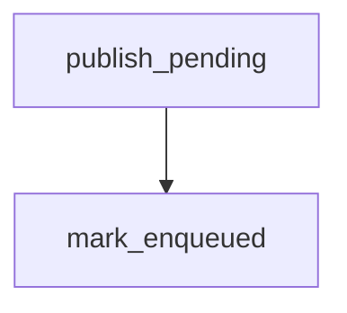

# mark_enqueued

**Type:** `function`  
**Defined in:** [core/outbox.py](../nodes/core_outbox_py.md) (Lines 60-68)  
**Component:** core (create_task)  

## Definition
```python
async def mark_enqueued(task_id: uuid.UUID) -> None
```

## Description
Отметить, что задача положена в Redis.

**Contained in parent:** [outbox.py](core_outbox_py.md) (`file`)

## Call Graph


### Incoming Calls (Backlinks)
- Called by [publish_pending](core_publisher_py_publish_pending.md) (`function`)
