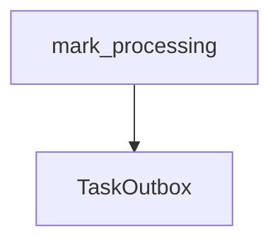

# mark_processing

**Type:** `function`  
**Defined in:** [core/outbox.py](../nodes/core_outbox_py.md) (Lines 71-85)  
**Component:** core (create_task)  

## Definition
```python
async def mark_processing(task_ids: list[uuid.UUID]) -> None
```

**Contained in parent:** [outbox.py](core_outbox_py.md) (`file`)

## Call Graph


### Outgoing Calls
- Calls [TaskOutbox](app_models_outbox_py_TaskOutbox.md) (`class`)
