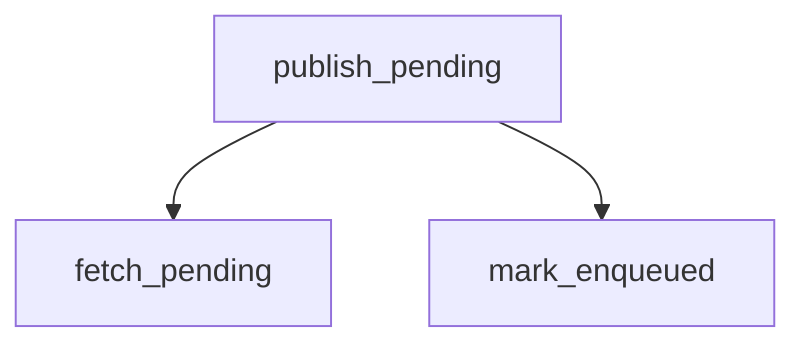

# publish_pending

**Type:** `function`  
**Defined in:** [core/publisher.py](../nodes/core_publisher_py.md) (Lines 15-57)  
**Component:** TaskOutbox  

## Definition
```python
async def publish_pending(ctx=None, limit: int = 100) -> int
```

## Description
Издатель: читает pending из outbox и кладёт в Redis.
    
    Также возвращает в pending задачи, которые зависли в enqueued > 5 минут.

**Contained in parent:** [publisher.py](core_publisher_py.md) (`file`)

## Call Graph


### Outgoing Calls
- Calls [fetch_pending](core_outbox_py_fetch_pending.md) (`function`)
- Calls [mark_enqueued](core_outbox_py_mark_enqueued.md) (`function`)
