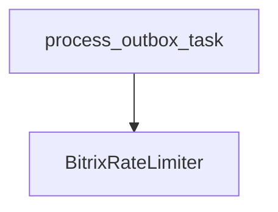

# BitrixRateLimiter

**Type:** `class`  
**Defined in:** [core/rate_limiter.py](../nodes/core_rate_limiter_py.md) (Lines 50-106)  
**Component:** core (BitrixRateLimiter)  

## Definition
```python
class BitrixRateLimiter
```

## Description
Ограничитель скорости для запросов к Битрикс24.

**Contained in parent:** [rate_limiter.py](core_rate_limiter_py.md) (`file`)

## Contains Symbols
- [__init__](core_rate_limiter_py_BitrixRateLimiter___init__.md) (`method`)
- [acquire](core_rate_limiter_py_BitrixRateLimiter_acquire.md) (`method`)
- [wait_and_acquire](core_rate_limiter_py_BitrixRateLimiter_wait_and_acquire.md) (`method`)

## Call Graph


### Incoming Calls (Backlinks)
- Called by [process_outbox_task](worker_tasks_py_process_outbox_task.md) (`function`)
