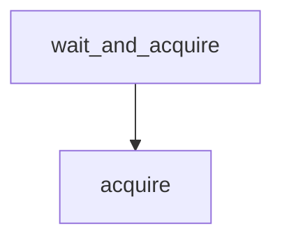

# acquire

**Type:** `method`  
**Defined in:** [core/rate_limiter.py](../nodes/core_rate_limiter_py.md) (Lines 66-95)  
**Component:** core (BitrixRateLimiter)  

## Definition
```python
async def acquire(self) -> bool
```

## Description
Попытаться получить разрешение на запрос.
        Возвращает True, если можно выполнять, False — если нужно подождать.

**Contained in parent:** [BitrixRateLimiter](core_rate_limiter_py_BitrixRateLimiter.md) (`class`)

## Call Graph


### Incoming Calls (Backlinks)
- Called by [wait_and_acquire](core_rate_limiter_py_BitrixRateLimiter_wait_and_acquire.md) (`method`)
