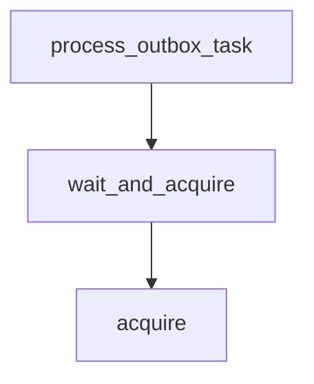

# wait_and_acquire

**Type:** `method`  
**Defined in:** [core/rate_limiter.py](../nodes/core_rate_limiter_py.md) (Lines 97-106)  
**Component:** core (BitrixRateLimiter)  

## Definition
```python
async def wait_and_acquire(self, max_wait: float = 30.0) -> bool
```

## Description
Ждать, пока не появится токен (с ограничением по времени).

**Contained in parent:** [BitrixRateLimiter](core_rate_limiter_py_BitrixRateLimiter.md) (`class`)

## Call Graph


### Outgoing Calls
- Calls [acquire](core_rate_limiter_py_BitrixRateLimiter_acquire.md) (`method`)

### Incoming Calls (Backlinks)
- Called by [process_outbox_task](worker_tasks_py_process_outbox_task.md) (`function`)
