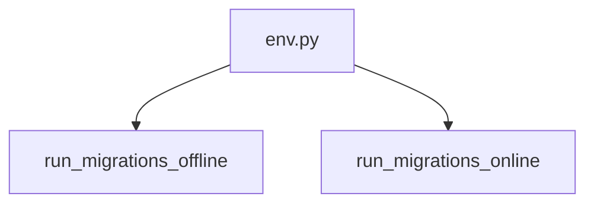

# env.py

**Type:** `file`  
**File path:** `migrations/env.py`  
**Component:** run_async_migrations  

## Definition
```python
module env.py
```

## Contains Symbols
- [do_run_migrations](migrations_env_py_do_run_migrations.md) (`function`)
- [run_async_migrations](migrations_env_py_run_async_migrations.md) (`function`)

## Imports
- [config.py](app_config_py.md)
- [db.py](app_db_py.md)
- [__init__.py](app_models___init___py.md)

## Call Graph


### Outgoing Calls
- Calls [run_migrations_offline](migrations_env_py_run_migrations_offline.md) (`function`)
- Calls [run_migrations_online](migrations_env_py_run_migrations_online.md) (`function`)
