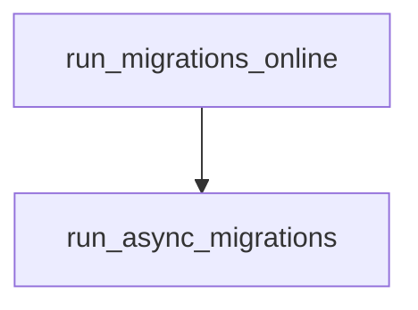

# run_async_migrations

**Type:** `function`  
**Defined in:** [migrations/env.py](../nodes/migrations_env_py.md) (Lines 44-54)  
**Component:** run_async_migrations  

## Definition
```python
async def run_async_migrations() -> None
```

**Contained in parent:** [env.py](migrations_env_py.md) (`file`)

## Call Graph


### Incoming Calls (Backlinks)
- Called by [run_migrations_online](migrations_env_py_run_migrations_online.md) (`function`)
