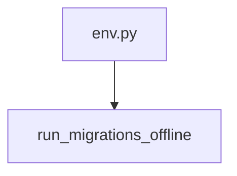

# run_migrations_offline

**Type:** `function`  
**Defined in:** [migrations/env.py](../nodes/migrations_env_py.md) (Lines 24-34)  
**Component:** run_async_migrations  

## Definition
```python
def run_migrations_offline() -> None
```

## Call Graph


### Incoming Calls (Backlinks)
- Called by [env.py](migrations_env_py.md) (`file`)
