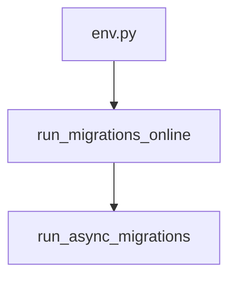

# run_migrations_online

**Type:** `function`  
**Defined in:** [migrations/env.py](../nodes/migrations_env_py.md) (Lines 57-58)  
**Component:** run_async_migrations  

## Definition
```python
def run_migrations_online() -> None
```

## Call Graph


### Outgoing Calls
- Calls [run_async_migrations](migrations_env_py_run_async_migrations.md) (`function`)

### Incoming Calls (Backlinks)
- Called by [env.py](migrations_env_py.md) (`file`)
