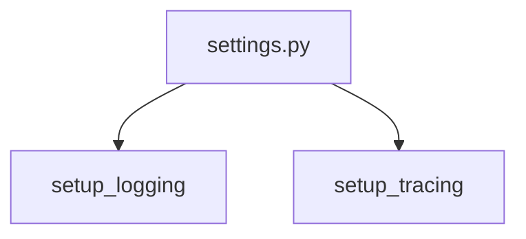

# settings.py

**Type:** `file`  
**File path:** `worker/settings.py`  
**Component:** instrument_app  

## Definition
```python
module settings.py
```

## Contains Symbols
- [WorkerSettings](worker_settings_py_WorkerSettings.md) (`class`)

## Imports
- [config.py](app_config_py.md)
- [logging_config.py](app_logging_config_py.md)
- [publisher.py](core_publisher_py.md)
- [tasks.py](worker_tasks_py.md)
- [telemetry.py](app_telemetry_py.md)

## Call Graph


### Outgoing Calls
- Calls [setup_logging](app_logging_config_py_setup_logging.md) (`function`)
- Calls [setup_tracing](app_telemetry_py_setup_tracing.md) (`function`)
