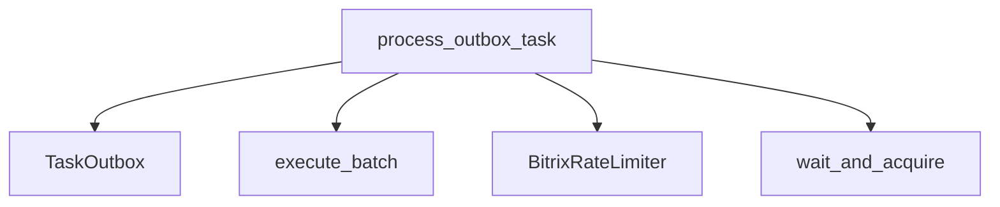

# process_outbox_task

**Type:** `function`  
**Defined in:** [worker/tasks.py](../nodes/worker_tasks_py.md) (Lines 112-211)  
**Component:** process_outbox_task  

## Definition
```python
async def process_outbox_task(ctx, task_id: str, payload: dict) -> dict
```

## Description
Обработчик задачи из outbox с batch-оптимизацией.

    Вместо одной задачи берёт до 50 pending/enqueued-задач и отправляет их одним batch-запросом.

**Contained in parent:** [tasks.py](worker_tasks_py.md) (`file`)

## Call Graph


### Outgoing Calls
- Calls [TaskOutbox](app_models_outbox_py_TaskOutbox.md) (`class`)
- Calls [BitrixRateLimiter](core_rate_limiter_py_BitrixRateLimiter.md) (`class`)
- Calls [wait_and_acquire](core_rate_limiter_py_BitrixRateLimiter_wait_and_acquire.md) (`method`)
- Calls [execute_batch](core_bitrix_batch_py_execute_batch.md) (`function`)
