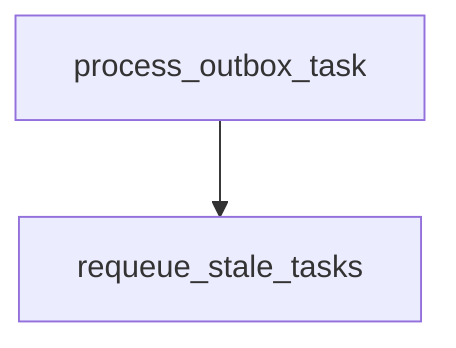

# requeue_stale_tasks

**Type:** `function`  
**Defined in:** [worker/tasks.py](../nodes/worker_tasks_py.md) (Lines 66-92)  
**Component:** worker (process_outbox_task)  

## Definition
```python
async def requeue_stale_tasks(ctx)
```

## Description
Watchdog: возвращает зависшие processing-задачи в pending.

**Contained in parent:** [tasks.py](worker_tasks_py.md) (`file`)

## Call Graph


### Incoming Calls (Backlinks)
- Called by [process_outbox_task](worker_tasks_py_process_outbox_task.md) (`function`)
