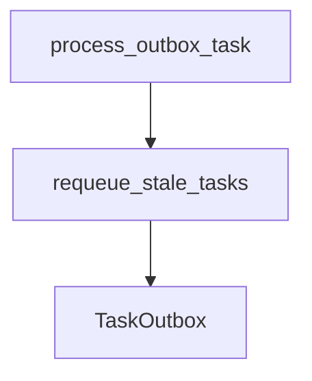

# requeue_stale_tasks

**Type:** `function`  
**Defined in:** [worker/tasks.py](../nodes/worker_tasks_py.md) (Lines 66-100)  
**Component:** worker (process_outbox_task)  

## Definition
```python
async def requeue_stale_tasks(ctx)
```

## Description
Watchdog: возвращает зависшие processing-задачи в pending.

    Ловит два случая:
    1. processing_started_at < now() - 5 min (старые задачи)
    2. processing_started_at IS NULL (сироты — задачи без таймстампа)

**Contained in parent:** [tasks.py](worker_tasks_py.md) (`file`)

## Call Graph


### Outgoing Calls
- Calls [TaskOutbox](app_models_outbox_py_TaskOutbox.md) (`class`)

### Incoming Calls (Backlinks)
- Called by [process_outbox_task](worker_tasks_py_process_outbox_task.md) (`function`)
